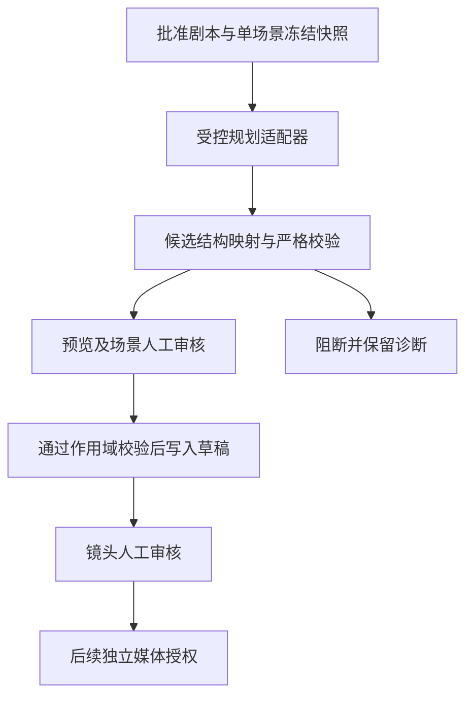

# ViMax Script2Video 分镜规划层复用评估

状态：**设计与评估计划，未实施接入**。更新：2026-10-29。这里的“红果项目”指我们现有的 AI Drama Studio 竖屏短剧工作台，不表示红果平台授权、接口接入或自动发布。

本轮仅更新文档。没有引入 ViMax 依赖、执行其流水线、创建业务记录、修改 Schema、启用开关、执行 Migration、部署或发送模型/媒体请求。下面的验收条目均为后续工作的要求，不是本轮通过记录。

## 1. 结论与现有基线

推荐在现有平台内评估复用 **Script2Video 的文本分镜规划方法与输出结构**：先做隔离、无网络的候选适配与校验，再决定是否提取上游代码。首个样本限定为**短剧模式中一集已批准剧本的一个明确场景**。不以运行整套 ViMax 替换我们的项目、审核、计费或恢复系统。

本项目核查基线为 `125287dfbfca9ac969dbe54a12ab45007c0b3a59`；ViMax 源码核查基线为 `fd4b72e7731be6e5f88486206d25ea59849b0285`。仅按固定版本做源码评估，没有在本项目运行 ViMax，也未测量其真实质量、耗时、成本或模型兼容性。

| 现有能力与边界 | 本次设计如何衔接 |
| --- | --- |
| 短剧文本支持 1–6 集；系列独立支持 1–60 集文本 | 第一阶段只选短剧的一个场景；系列仍保留 `SERIES_MEDIA_NOT_ENABLED`，不据此开放系列分镜生产或媒体链 |
| 已有按批准剧本拆解的文字功能 | 复用 [`SCRIPT_BREAKDOWN.md`](SCRIPT_BREAKDOWN.md) 的输入冻结、结果校验和两段式审核规则；其现有保存会替换整集，单场景候选不可直接写入，不再建一套 Scene/Shot 业务模型 |
| `Scene/SceneRevision`、`Shot/ShotRevision`、角色引用、人工审核和 STALE | ViMax 输出只是候选。先预览与校验，再经现有审核/写入路径创建草稿；不自动批准或覆盖人工版本 |
| 调用预算、日限额、幂等、租约、未知结果处理 | 每次规划模型发送也须纳入既有调用治理；上游文件缓存与重试不能替代这些记录 |
| 配音设计与 M4 技术闭环各有独立验收边界 | 本评估不交付人声、视频或可发布成片；参见 [`CHARACTER_VOICE_DESIGN.md`](CHARACTER_VOICE_DESIGN.md) 和 [`M4_CLOSEOUT_REPORT.md`](M4_CLOSEOUT_REPORT.md) |

既有 15 / 19 / 96 次系列调用公式只涵盖系列文本流程；未来分镜规划是新增范围，不借用或转移旧授权剩余预算。当前已实现代码、部署状态、替身验收与真实创作通过是四件不同的事。

## 2. 上游可以复用什么

固定版本的 [`Script2VideoPipeline.plan_text_artifacts`](https://github.com/HKUDS/ViMax/blob/fd4b72e7731be6e5f88486206d25ea59849b0285/pipelines/script2video_pipeline.py) 在角色立绘、帧图、视频与拼接之前停止，返回 `characters`、`storyboard`、`shot_descriptions`、`camera_tree`。它是文本规划入口，**不是零调用纯函数**。

| 上游环节 | 本项目的评估取舍 |
| --- | --- |
| CharacterExtractor：角色文字信息；可传入角色跳过提取 | 优先使用本项目冻结的角色版本。未知或同名角色需人工消歧；不把提取结果当作新的批准角色 |
| StoryboardArtist：连续镜头的视觉/音频描述与机位分组 | 首选复用目标；输入必须是一个场景。整集多场景须先由本项目明确场景边界，不直接投给单场景规划器 |
| 逐镜视觉分解：首帧、尾帧、运动、可见角色 | 作为分镜文本候选；不等于已有首尾帧图片，不保证台词保真、可拍性或时长 |
| camera tree：机位间视觉参考关系 | 保留为候选内的视觉依赖结构，单独校验；不是剧情依赖或播放顺序 |
| ReferenceImageSelector、BestImageSelector、角色立绘和视频生成 | 本轮不接入；后续单独评估参考资产资格、候选数量、视觉模型成本和审核条件 |
| ViMax Web UI、文件式会话恢复、完整 agent loop | 不引入第二套工作台或业务状态源；继续使用现有 Web、API 和数据库 |

源码核查发现的接入约束：

- StoryboardArtist 的契约明确要求单场景；不能据入口名 `Script2Video` 推定可直接处理整集或 60 集。
- 角色提取、分镜设计、逐镜分解都有最多 3 次的内部重试，camera tree 另有最多 2 次外层尝试；逐镜分解可并发。实际调用数随镜头数、已有角色和缓存变化，不能照搬“一次拆解等于一次调用”。
- 工作目录缓存主要按文件是否存在复用，不核对我们的输入哈希、来源版本、审批或模型配置。不能把文件存在当作业务完成证据。
- `plan_text_artifacts` 虽接收 `style`，核查版本的 helper 正文未使用它；竖屏、风格与拍摄约束必须明确进入后续请求契约并测试，不能假定该参数已生效。
- 视觉模型挑图和多候选生成会另增调用；本阶段不启用这些组件。现有 DeepSeek 文本配置能否满足拟采用的规划协议尚未验证，不因参考项目而自动切换供应商或要求 OpenAI。

## 3. 用户功能与页面目标

入口沿用工作台中的剧本/分镜区域，不新建外部创作入口。以下交互均为拟设计，现有页面本轮不变：

1. 创作者选一集当前、已批准且非 STALE 的剧本，并明确一个场景及其原文范围；预览来源版本、人物与约束。首轮评估使用经允许的脱敏样本或合成 fixture，不读取线上作品来调用模型。
2. 查看“分镜文字方案”的范围与来源；未来真实调用时，展示规划供应商/模型、正常调用与允许重发上限、最大预算、费用未知等信息，单独明确确认。
3. 按镜头查看景别、构图/运镜、动作、对白、角色、预计时长、首尾帧文字与视觉参考关系；并排展示原场景文本。预计时长和首尾帧描述不能显示成实测时长或已生成图片。
4. 显示不可映射的字段、未知角色、对白变化、缺失时长、循环或越界引用等阻断；可退回修改，不能静默删镜头、补台词、合并身份或自动降级为可写。
5. 只有完成下述单场景写入作用域设计并通过验收后，才可按现有审核顺序写入：场景草稿 → 人工批准场景 → 写入镜头草稿 → 人工审核镜头。E1 不写入；审核动作不隐含任何媒体生成授权。
6. 修改来源后，旧候选保留可读并显示失效；不自动重生。单镜修改的影响范围依据真实来源边计算，视觉依赖的后继镜头也须重新核查。

## 4. 接入边界与候选映射

“受控规划适配器”是待验证的边界，不是已新增的 API、运行种类或持久化表。先提取可独立验证的规划契约/映射；是否采用 Python 子进程/服务或按现有 TypeScript Adapter 实现，在离线评估后确定。无论采用哪种方式，都不得让上游直接写业务数据库、使用线上工作目录或持有浏览器传来的密钥。

### 输入与来源

输入冻结作品/集、批准剧本的 revision ID 与内容哈希、明确的单场景原文及定位、当前角色 revision ID、目标时长、竖屏/风格要求、模型配置身份、上游 SHA 与适配/提示版本。这里是拟定的审计要求，不是已经新增的 HTTP 字段。场景定位必须能在冻结剧本中逐字验证；歧义、越界或来源变化阻断。

| ViMax 候选 | 本项目目标与缺口 |
| --- | --- |
| `characters` 及其局部索引 | 映射到冻结角色键和 revision ID；局部索引不是数据库 UUID，名称不能单独证明身份 |
| `storyboard` 的 `idx/is_last/cam_idx/visual_desc/audio_desc` | 镜头顺序与视觉/声音意图的候选；不自动把 `audio_desc` 当作逐字对白，也不把 `cam_idx` 当作场景 ID |
| `shot_descriptions` 的首尾帧描述、可见角色索引、`motion_desc` 等 | 评估映射到已有景别、camera、action、dialogue、characterKeys；必须保留来源并验证，不凭猜测截短到字段上限 |
| `camera_tree` 的 `parent_cam_idx/parent_shot_idx` | 表达取哪个父机位镜头作为视觉参考；不直接写 `GenerationJobDependency`，也不复用系列伏笔 `dependsOn` |
| 上游没有结构化单镜时长与逐句台词来源 ID | 这是映射缺口；必须设计显式补齐/人工输入机制并验证，缺失时阻断写入，不编造实测时长或自动添加对白 |

当前拆解输出 `ads.script-breakdown.output.v1` 是 strict 契约，不接受新增的 camera tree/首尾帧字段。第一阶段将这些信息保留在**隔离评估候选**中，明确哪些可无损映射、哪些不能。确需运行时持久化或展示扩展信息时，另做版本化契约与兼容性设计；禁止塞入 `camera` 文本或任意 JSON 逃避验证，也不在本轮新增 Schema。

**单场景不能直接调用现有整集替换保存。** 当前拆解保存会归档冻结的本集旧场景/镜头，再写入新结果。将单场景候选包装为现有 v1 输出并复用该操作，会影响其他场景。本评估在 E1 只做隔离映射；E2 的目标是先设计并验收明确的单场景写入作用域与版本化契约，复用已有修订和审核规则，同时保护其他场景、镜头、人工修改及媒体来源。该作用域及并发条件未定义并通过验收前一律阻断写入，不靠自动补全整集来规避。

写入时继续遵循现有拆解限制与对白校验：最多 8 场、20 镜、每场 1–8 镜，模型拆解单镜预计 2–10 整秒；这些是拆解规则，不与手动编辑的 1–15 秒范围混用。不能通过删除输出、自动改名/改序号或截断正文使超限结果通过。

视觉依赖必须检查索引唯一、引用存在、归属正确、无自引用与循环，并确认采用上游树契约时根节点约束成立；`parent_shot_idx` 必须确实属于 `parent_cam_idx`。依赖的生成顺序与镜头播放顺序分别记录和验证。上游某些条件仅写在提示里，不能替代本地校验。

### 调用与恢复

- 离线阶段只使用冻结 JSON、合成剧本和模型替身，禁止外网。直接运行 `plan_text_artifacts` 不属于零调用验证。
- 进入真实规划前，需将每个内部 LLM 请求拆成可记账、可预约、可审计的发送，或证明其全部经过同一受控网关；禁止上游 SDK 隐式重试、自动 JSON 修复重发、缓存缺失重发或并发绕过预算。
- 不能复用现有 `script_breakdown` 的单步骤单调用假设来包装不透明的多次调用。实际阶段、最大镜头数、并发上限与允许重发须形成可计算预算，独立确认；无法建立上界时不进入付费试验。
- 每次预约、发送准入与保存均核对冻结来源和有效租约；来源变更时停止，禁止把新输入偷偷塞入旧授权。已提交/结果未知的请求保留成本与恢复记录，不自动退款或重发。
- 候选缓存及冻结执行身份绑定冻结输入、模型、上游和适配版本；文件目录只是受控临时产物。**请求幂等与冻结执行身份分开**：原键、原请求重放先返回原任务/回执，不因当前剧本或默认模型变化而重新冻结、拒绝原回执或再发送；真实续跑/写入仍检查冻结来源是否有效。数据库仍是任务/审核/调用真相。

## 5. 分阶段评估与退出条件

| 阶段 | 交付物与通过条件 | 当前状态 |
| --- | --- | --- |
| E0 设计核查 | 固定上游版本、许可、输入输出与调用边界，形成本文及现有文档入口 | 本轮完成源码评估与文档，不等于功能接入 |
| E1 离线适配原型 | 单场景的合成/脱敏批准剧本 fixture、候选映射报告、严格校验与故障用例；零网络、零业务库写入、零付费调用 | 待实施 |
| E2 平台集成验证 | 单场景写入作用域、适配/预算契约经审查后，以替身跑持久化、发送边界、审核、STALE、恢复和 UI；临时数据库使用已批准迁移 | 待 E1 决策；不承诺无需新迁移 |
| E3 受限真实文本规划 | 单独授权一次明确模型/范围/预算的单场景试验；人工比较原文与方案，记录实际调用、token、未知费用和阻断 | 未授权、未执行；不含媒体 |
| E4 可选媒体试验 | 参考图选择、候选评审、图像/视频/声音分别设计并授权；审核后再进入现有媒体/合成链 | 不在本次范围 |

E1 至少包含：

- 正常单场景双角色样本；按冻结身份保留原对白、顺序与角色，反复映射相同 fixture 得到相同结果。该确定性只指映射器，不宣称 LLM 确定性。
- 多场景输入、未知/同名角色、缺失或额外字段、超长字段、漏对白/改对白、缺失或超限时长均明确报告并阻断，不静默修复。
- 机位/镜头重复索引、悬空引用、自引用、循环、父镜头归属错误及根约束错误均拒绝；合法的视觉生成依赖不被误认为剧情前置或播放顺序。
- 不执行图片、视频、配音或挑图；即使初始化/缓存缺失/异常路径也不能触网，网络尝试计为测试失败。
- 形成与现有 `script_breakdown` 的字段差异和人工修订清单。无法无损表达的内容记录为缺口，不能用“已映射”掩盖。

E2 必须再覆盖：重复启动/回执丢失不重复发送、预算不足发送为 0、上游隐式重试被拦截、预约前/提交前/保存前来源变更、未知结果恢复、取消/过期执行者、审批门和人工镜头不被覆盖、旧契约回放、系列媒体仍禁用。更新单场景时，其他场景、镜头和媒体来源不得被归档或覆盖；来源变化后的原请求回执重放不新增任务/调用。页面验收覆盖 1280px / 390px、阻断说明、版本提示及费用未知。

只有上述边界可验证、原文保真并能复用现有审核链时才进入 E2；若必须绕过预算/审批、静默改变剧本或无安全的无损映射，就停止该接入，保留现有拆解方案。真实方案的叙事连贯性、可拍性和竖屏构图需人工评审，不以 Schema 通过代替质量验收。

## 6. 风险、许可与未决事项

- 上游以 Python 为主，而现有文本领域/引擎以 TypeScript 为主。新增运行时、依赖锁、沙箱、超时与恢复成本须在 E1 后比较；本轮不安装或复制源码。
- ViMax 的 [LICENSE](https://github.com/HKUDS/ViMax/blob/fd4b72e7731be6e5f88486206d25ea59849b0285/LICENSE) 标为 MIT。若后续复制/修改代码或提示，保留版权和许可，并更新第三方清单；依赖、模型、字体、声音、参考图和素材权利需分别核查，仓库许可不替代这些权利。
- 生产剧本与用户素材不放入公开 GitHub fixture，不上传到上游 demo；后续数据发送仅走已授权供应商和既有密钥管理。剧本文本作为数据，不允许其中指令改变工具权限或发起额外调用。
- 真实文本模型的输出适配、调用上界、风格约束有效性、首尾帧/机位树的持久化形式仍待 E1/E2 确认。本文不承诺质量提升比例、生成速度、免费额度或 60 集自动成片。
- 系列文本闭环、角色配音方案和原有 M1–M4 验收结论保持独立。本项不修复历史 `arc` 拒收，也不会自动续跑旧作品。

## 7. 核查来源

本项目：[`PRODUCT_SCOPE.md`](PRODUCT_SCOPE.md)、[`IMPLEMENTATION_PLAN.md`](IMPLEMENTATION_PLAN.md)、[`SCRIPT_BREAKDOWN.md`](SCRIPT_BREAKDOWN.md)、[`SERIES_WRITING.md`](SERIES_WRITING.md)、[`ARCHITECTURE.md`](ARCHITECTURE.md)、[`VERSION_AND_STALE_RULES.md`](VERSION_AND_STALE_RULES.md)。历史 V1 的三集基线保留，当前 1–6 集短剧/1–60 集系列边界以系列文档为准。

ViMax 固定提交下的源码：

- [Script2VideoPipeline](https://github.com/HKUDS/ViMax/blob/fd4b72e7731be6e5f88486206d25ea59849b0285/pipelines/script2video_pipeline.py)：文本规划入口、缓存与 camera tree 外层重试。
- [StoryboardArtist](https://github.com/HKUDS/ViMax/blob/fd4b72e7731be6e5f88486206d25ea59849b0285/agents/storyboard_artist.py)、[CharacterExtractor](https://github.com/HKUDS/ViMax/blob/fd4b72e7731be6e5f88486206d25ea59849b0285/agents/character_extractor.py)、[CameraImageGenerator](https://github.com/HKUDS/ViMax/blob/fd4b72e7731be6e5f88486206d25ea59849b0285/agents/camera_image_generator.py)：单场景契约、逐镜分解与机位规划。
- [镜头结构](https://github.com/HKUDS/ViMax/blob/fd4b72e7731be6e5f88486206d25ea59849b0285/interfaces/shot_description.py)、[机位结构](https://github.com/HKUDS/ViMax/blob/fd4b72e7731be6e5f88486206d25ea59849b0285/interfaces/camera.py)、[角色结构](https://github.com/HKUDS/ViMax/blob/fd4b72e7731be6e5f88486206d25ea59849b0285/interfaces/character.py)：候选字段与索引。
- [ReferenceImageSelector](https://github.com/HKUDS/ViMax/blob/fd4b72e7731be6e5f88486206d25ea59849b0285/agents/reference_image_selector.py)、[BestImageSelector](https://github.com/HKUDS/ViMax/blob/fd4b72e7731be6e5f88486206d25ea59849b0285/agents/best_image_selector.py)：后续参考图选择和视觉评审范围，本阶段不启用。
